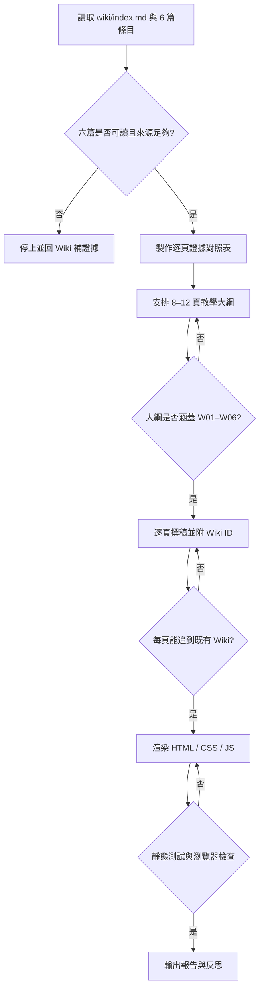

# 從 Wiki 到教學 HTML 簡報｜Graph 設計

> 前提：使用已完成的 6 篇 Wiki 條目，不在簡報階段直接從外部網站自由補充知識。

## 節點輸入／輸出／關卡

| 節點 | 可讀內容 | 輸出 | 驗收、失敗回退 |
|---|---|---|---|
| 來源覆蓋 | `wiki/index.md`, `wiki/topics/*.md` | 已選 W01–W06 | 少於五篇來源則停止，不自行補造 |
| 證據對照 | Wiki 條目與來源 ID | `slide-sources.csv` | 每頁至少一篇 Wiki 依據，沒引用退回對照 |
| 大綱 | 證據對照 | 11 頁題綱 | 8–12 頁、W01–W06 全涵蓋，否則退回大綱 |
| 逐頁撰稿 | 題綱與對應 Wiki | 逐頁文字 | 避免擅加無據數字，忠實度不足只修錯頁 |
| HTML 渲染 | 審過的逐頁稿 | `slides/index.html` | 不任意擴充技術敘述；檢查 RWD、操作與引用 |
| 最終檢查 | HTML + Wiki | `reports/validation.md` | 靜態程式測試 + 真正瀏覽器的互動驗證 |

## 小 Loop 與停止條件

- **引用小圈**：撰稿 → 確認 Wiki ID → 只修無依據的段落，最多 3 輪。
- **排版小圈**：渲染 → 截圖／檢查 → 只修改排版或控制項，最多 3 輪。
- **停止**：來源不足、來源矛盾無法釐清或修正滿三輪仍失敗，應記錄 blocker，不捏造完成。
- **人工確認點**：進入 HTML 前確認大綱；交件前人工抽看兩張投影片的概念說明。

設計理由：講義強調「錯在哪一關，就退回哪一關」，避免把字太多或錯連結這類局部問題變成整份重新生成。
